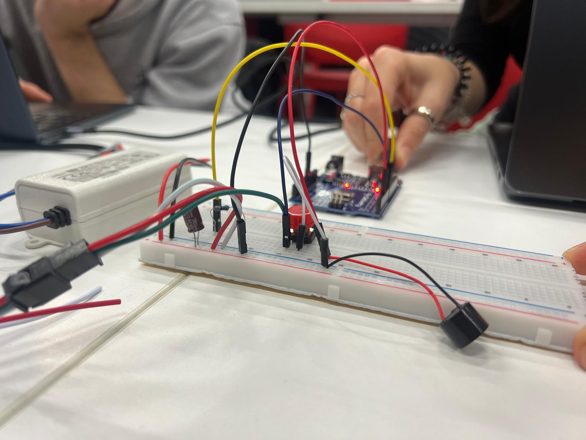
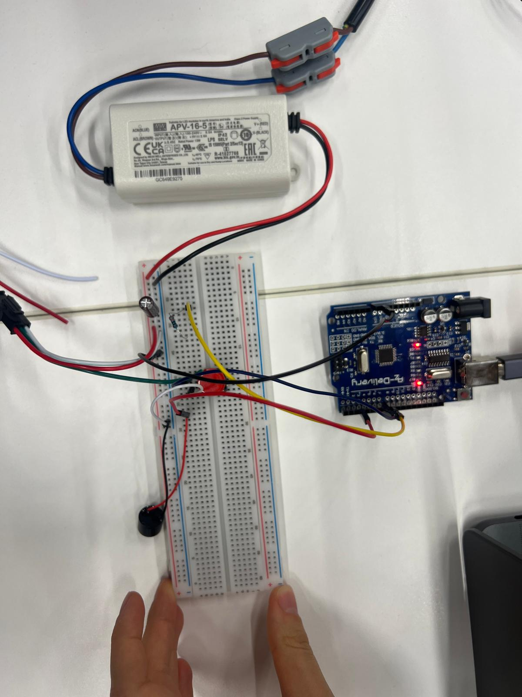
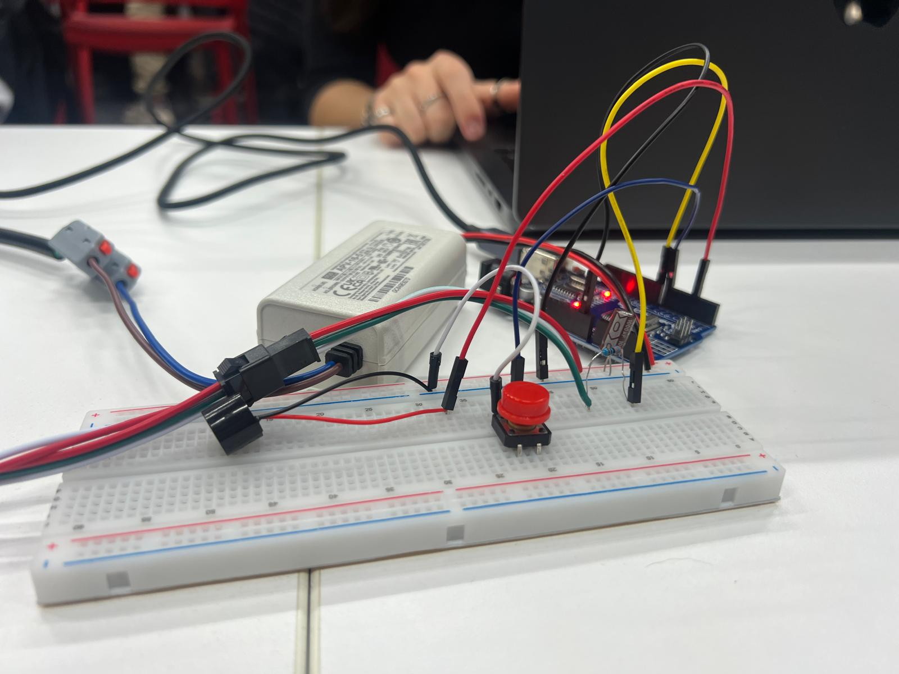
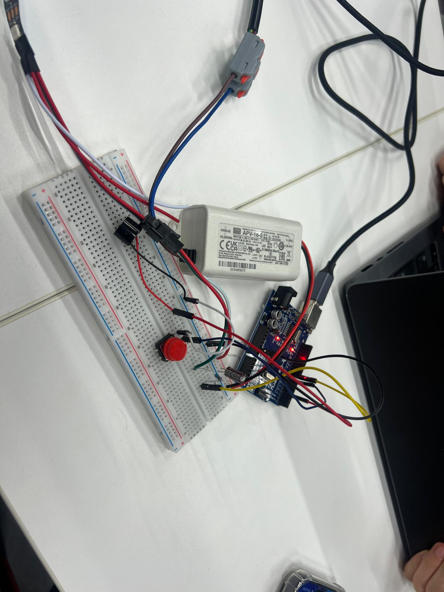

# Session 4 · Visual feedback

**Thu 12/11** · _Addressable LED strips with FastLED: wiring, colour, effects_

**Team:** _Eira Turró, Raul Ruiz, Xènia Gual, Carla Milene_

---

## Challenge: The object that answers

Make an object that greets, guides and thanks its user with light. Start from your night light or a new idea.

**Must have**

- [x] An idle light that invites a touch
- [x] A different light for each state
- [ ] One animation made with `EVERY_N_MILLISECONDS`
- [x] LEDs diffused, never bare

**Hand in by 11:30**

- Code
- Video

---

## What we built

El nostre projecte consisteix en crear un despertador que combina llum i so. Inicialment, el sistema està apagat i, quan arriba l’hora programada, s’activa l’alarma.

Primer, una llum blanca augmenta progressivament la seva intensitat, des de zero fins a la brillantor màxima, il·luminant tota l’habitació. Un cop arriba al màxim, comencen unes pampallugues que s’encenen i s’apaguen, acompanyades d’un so de que es repeteix al mateix ritme.

Finalment, quan l’usuari prem el botó, tant la llum com el so s’apaguen. D’aquesta manera, es crea un despertador que et desperta progressivament combinant estímuls visuals i sonors.

## Materials

| Component / material | Quantity | Notes                                       |
| -------------------- | -------- | ------------------------------------------- |
| Arduino Uno          | 1        |                                             |
| Tira LEDS            | 1        |                                             |
| Condensador          | 1        |                                             |
| Resistència 330 Ω    | 1        |                                             |
| Font d'alimentació   | 1        |                                             |
| Botó                 | 1        |                                             |
| Jumpers              | 5        | 1 blanc, 1 vermell, 1 blau, 1 groc, 1 negre |
| Protoboard           | 1        |                                             |
| Cable USB            | 1        |                                             |
| Arduino Uno          | 1        |                                             |

## Photo

## Video

"video_proj4.mp4"

## Code

- Arduino sketch: [`ti04/ti04.ino`](ti04/ti04.ino)

## What each light means

| State             | Colour / animation                                    | Meaning for the user                        |
| ----------------- | ----------------------------------------------------- | ------------------------------------------- |
| Repòs             | Llum apagada                                          | L'alarma està inactiva                      |
| Inici de l'alarma | Llum blanca que augmenta progressivament d'intensitat | L'usuari comença a despertar-se             |
| Alarma activa     | Llum blanca que s'encén i s'apaga intermitentment     | L'alarma està sonant                        |
| Alarma aturada    | Llum apagada                                          | L'usuari ha aturat l'alarma prement el botó |

## Problems and fixes

Durant el desenvolupament del projecte, hem tingut alguns problemes tècnics, sobretot perquè els cables jumpers es desconnectaven constantment i això dificultava el funcionament del circuit.

Tot i aquests inconvenients, avui hem aconseguit entendre millor els conceptes, els termes i el vocabulari relacionats amb la programació d’Arduino, així com el funcionament del codi i les seves instruccions.

## Going further

Per anar més enllà de la idea inicial, que es basava únicament en una alarma de llum, hem decidit incorporar també un sistema de so. Aprofitant el funcionament de la llum, hem afegit un buzzer (brunzidor) d’Arduino perquè reprodueixi un senyal acústic sincronitzat amb les pampallugues.

D’aquesta manera, hem transformat la idea inicial en un despertador més complet, que combina estímuls visuals i sonors per facilitar que la persona es desperti.

## Use of AI

Hem utilitzat la IA com a eina de suport per millorar la redacció i l'expressió de la documentació del projecte, fent que els textos fossin més clars i entenedors. També ens ha ajudat a detectar i corregir errors del codi d'Arduino, tot i que ja teníem la base de la programació feta.
