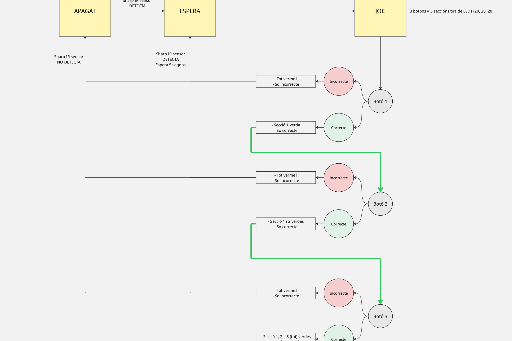

# Session 5 · Logic and states

**Tue 17/11** · _States and `switch/case`, arrays, functions, `millis()`, edge detection, RFID_

**Team:** _Eira Turró, Raul Ruiz, Xènia Gual_

---

## Challenge: The safe box (graded)

Build a box that only opens with the right sequence. The LED strip shows whether it is locked, listening or open; buttons, knocks or an RFID card are the key.

**Must have**

- [x] At least 3 states in a `switch/case`
- [x] A code of 3+ steps stored in an array
- [x] Wrong step resets, with feedback
- [x] Closes itself after 5 s, using `millis()`

**Hand in by 11:30**

- Code
- Video
- Photo of your state drawing

---

## What we built

La nostra caixa només s'obre amb la seqüència correcta de 3 botons.

- APAGAT: caixa en repòs. Si el sensor IR detecta algú, passa a ESPERA.
- ESPERA: la caixa "escolta". Si el sensor detecta la persona 5 segons, comença el JOC; si deixa de detectar-la, torna a APAGAT.
- JOC: cada botó encertat il·lumina una secció de la tira de LEDs en verd (1, 2 i 3) amb so correcte.
- Error: si algun botó és incorrecte, tota la tira es posa en vermell, sona un so d'error i cal tornar a començar.
- Final (tot bé): quan els tres botons són correctes, tota la tira queda en verd, sona la melodia final i la caixa s'obre.

## Materials

| Component / material | Quantity | Notes |
| -------------------- | -------- | ----- |
| Arduino Uno          | 1        |       |
|                      |          |       |
|                      |          |       |

## Photo

## Video

_Edit this file on github.com and drag your `.mp4` (under 10 MB) here, or paste an unlisted YouTube link._

## Code

- Arduino sketch: [`ti05/ti05.ino`](ti05/ti05.ino)
- _Other files (Tinkercad link, extra sketches…): add them to this folder or paste a link._

## States

| State     | LED strip shows | Goes to… when… |
| --------- | --------------- | -------------- |
| LOCKED    |                 |                |
| LISTENING |                 |                |
| OPEN      |                 |                |

**The key:** _buttons / knocks / RFID card, and the sequence._

## Problems and fixes

_One thing that went wrong and what you did about it._

## Going further

_Did you try the “going further” idea from the slide? What happened?_

## Use of AI

_Where did you use AI today (explaining an error, ideas, reviewing…)? What did you change or check yourselves?_
