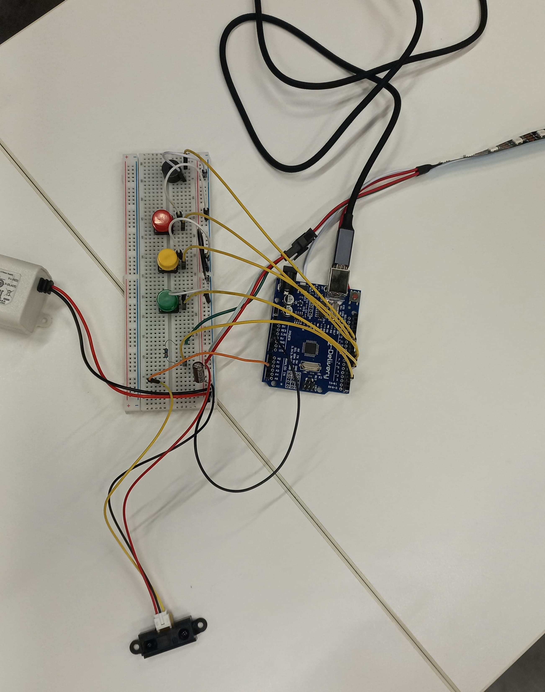

# Session 5 · Logic and states

**Tue 17/11** · _States and `switch/case`, arrays, functions, `millis()`, edge detection, RFID_

**Team:** _Eira Turró, Raul Ruiz_

---

## Challenge: The safe box (graded)

Build a box that only opens with the right sequence. The LED strip shows whether it is locked, listening or open; buttons, knocks or an RFID card are the key.

**Must have**

- [x] At least 3 states in a `switch/case`
- [x] A code of 3+ steps stored in an array
- [x] Wrong step resets, with feedback
- [x] Closes itself after 5 s, using `millis()`

**Hand in by 11:30**

- Code
- Video
- Photo of your state drawing

---

## What we built

La nostra caixa només s'obre amb la seqüència correcta de 3 botons.

- APAGAT: caixa en repòs. Si el sensor IR detecta algú, passa a ESPERA.
- ESPERA: la caixa "escolta". Si el sensor detecta la persona 5 segons, comença el JOC; si deixa de detectar-la, torna a APAGAT.
- JOC: cada botó encertat il·lumina una secció de la tira de LEDs en verd (1, 2 i 3) amb so correcte.
- Error: si algun botó és incorrecte, tota la tira es posa en vermell, sona un so d'error i cal tornar a començar.
- Final (tot bé): quan els tres botons són correctes, tota la tira queda en verd, sona la melodia final i la caixa s'obre.

## Materials

| Component / material | Quantity | Notes                                            |
| -------------------- | -------- | ------------------------------------------------ |
| Arduino Uno          | 1        |                                                  |
| Tira LEDS            | 1        |                                                  |
| Condensador          | 1        |                                                  |
| Resistència 330 Ω    | 1        |                                                  |
| Font d'alimentació   | 1        |                                                  |
| Botons               | 3        |                                                  |
| Buzzer               | 1        |                                                  |
| Jumpers              | 5        | 4 blancs, 1 vermell, 6 grocs, 1 negre, 1 taronga |
| Protoboard           | 1        |                                                  |
| Cable USB            | 1        |                                                  |
| Arduino Uno          | 1        |                                                  |

## Photo

## Video

"video_proj5.MOV"

## Code

- Arduino sketch: [`ti05/ti05.ino`](ti05/ti05.ino)

## States

| State            | LED strip shows                                                         | Goes to… when…                                |
| ---------------- | ----------------------------------------------------------------------- | --------------------------------------------- |
| Tancat           | Leds apagats                                                            | Encara no t'has acostat al lector             |
| Obert, en espera | Corre una llum blanca                                                   | El sensor t'ha detectat i el joc s'ha activat |
| Joc, escoltant   | S'il·luminen els leds en verd i vermell i el buzxer fa un determinat so | Cliques un botó                               |

## Problems and fixes

Hem tingut diverses dificultats amb el sensor IR. En primer lloc, el sensor que teníem inicialment no funcionava correctament i, posteriorment, també hem trobat complicacions a l'hora de configurar-lo i integrar-lo adequadament al codi del projecte.

## Going further

També havíem volgut incorporar un sensor IR al nostre projecte, però finalment no hem pogut acabar d'implementar-lo. D'altra banda, havíem plantejat afegir estímuls diferents per indicar que el codi s'havia introduït correctament, com ara llums de diversos colors i la reproducció d'una cançó coneguda. Tot i això, per qüestions de temps, hem decidit mantenir el funcionament bàsic inicial i prioritzar que les funcionalitats principals del projecte funcionessin correctament.

## Use of AI

Per desenvolupar el nostre projecte, ens hem basat principalment en els apunts que vam prendre el dia que en Jodir ens va presentar el seu projecte i ens va explicar el codi que havia utilitzat per crear la seva caixa forta. A partir d'aquesta base, hem utilitzat la intel·ligència artificial com a eina de suport per completar i adaptar el codi a les necessitats del nostre projecte.

Durant tot aquest procés, hem supervisat i revisat les propostes de la IA, aportant el nostre propi feedback i fent els ajustos necessaris per assegurar-nos que el resultat final s'adaptés al que volíem aconseguir.
